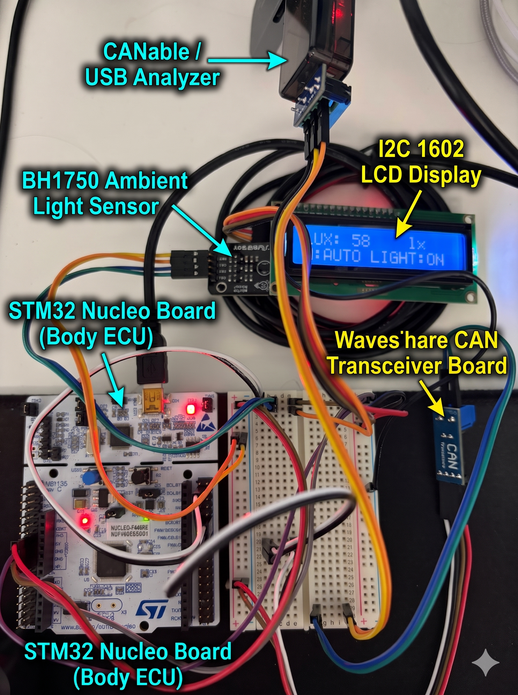

# STM32 CAN/UDS-based Body ECU & PC Diagnostic System

> **STM32 MCU와 Python PySide6 기반으로 구축된 CAN 버스 양방향 제어 및 UDS(ISO 14229) 스타일 차량 진단 시스템**

---

## 📌 1. 프로젝트 개요 (Overview)

본 프로젝트는 실제 차량의 **Body Control Module 중 헤드라이트 제어부(HCM: Headlight Control Module)**를 모사한 임베디드 ECU 펌웨어와, 차량 상태 모니터링 및 고장 진단을 수행하는 **PC 기반 진단 스캐너(Diagnostic Scanner)**를 개발한 프로젝트입니다.

CAN 2.0B 통신을 기반으로 데이터 텔레메트리, 원격 모드 제어, 그리고 **UDS(ISO 14229) / OBD-II 규격 스타일의 진단 프로토콜**을 적용하여 **`고장 감지 → DTC 스캔 → 부품 수리 → 메모리 소거(Clear)`**로 이어지는 실제 정비 스캐너의 진단 메커니즘을 구현했습니다.

### 🎯 주요 학습 및 구현 목표
- **CAN 2.0B Protocol Design:** 500kbps 통신속도 기반 ID 분류 및 양방향 메시지 구조 설계
- **STM32 Firmware Engineering:** CAN RX FIFO Interrupt 기반 비동기 데이터 처리 및 `HAL_GetTick()` 기반 Non-blocking FSM 설계
- **UDS Diagnostic Mechanism:** UDS Service ID (`0x19`, `0x14`, `0x2F`) 응용 및 State-based DTC Management(상태 기반 고장코드 관리) 구현
- **PC Diagnostic Tool Development:** PySide6 멀티스레딩(Worker Thread)과 `python-can` 라이브러리를 활용한 real-time UI/Logging 스캐너 구축

---

## 📐 2. 시스템 아키텍처 (System Architecture)

```
[ BH1750 센서 / Relay ] 
       │ (I2C / GPIO)
       ▼
[ STM32 Nucleo Body ECU ] ───(CAN 2.0B / 500kbps)───► [ CANable (SLCAN) ] ───(USB Serial)───► [ PC Diagnostic Scanner ]
  - CAN RX Interrupt                                  - USB Transceiver                            - PySide6 Multi-thread UI
  - Non-blocking Task Timing                                                                       - Telemetry Dashboard
  - Fault State Machine                                                                            - UDS DTC Diagnostics
```

---

## 🛠️ 3. 하드웨어 및 핀 구성 (Hardware Specification)

### 3.1 사용 하드웨어
- **MCU Board:** STM32 Nucleo Board (NUCLEO-F401RE / F103RB)
- **Transceiver:** CANable 1.0 (SLCAN Firmware)
- **Sensors & Actuators:** BH1750 I2C 조도 센서, 1602 I2C LCD Display, Headlight Actuator (On-board LED / Single Relay)

### 3.2 주요 Pin Map Configuration
| Peripheral | Pin Name | Description |
| :--- | :--- | :--- |
| **CAN1** | PA11 / PA12 | CAN RX / CAN TX (500 kbps) |
| **I2C1** | PB6 / PB7 | SCL / SDA (BH1750 Sensor & 1602 LCD) |
| **GPIO** | PA5 (or PB0) | Headlight Actuator Control (Relay Out) |


*(사진 캡션: STM32 Nucleo, CANable 1.0, BH1750 센서 및 LCD 벤치 구동 환경)*

---

## 📡 4. CAN 통신 및 UDS 진단 프로토콜 명세 (Protocol Specification)

### 4.1 CAN Frame ID Layout
본 프로젝트는 주행/제어용 데이터와 진단 통신 전용 CAN ID를 구분하여 설계되었습니다.

| CAN ID | Frame Type | DLC | Description |
| :---: | :--- | :---: | :--- |
| **`0x100`** | Telemetry (ECU → PC) | 8 bytes | 실시간 조도 센서 값, 모드 상태(AUTO/MANUAL), 라이트 ON/OFF 전송 (50ms 주기) |
| **`0x200`** | Remote Control (PC → ECU) | 8 bytes | 수동/자동 모드 전환, 수동 라이트 제어 명령 |
| **`0x7E0`** | Diag Physical Request (PC → ECU) | 8 bytes | UDS 진단 서비스 요청 (Request) |
| **`0x7E8`** | Diag Physical Response (ECU → PC) | 8 bytes | UDS 진단 서비스 응답 (Response) |

### 4.2 UDS Service ID (SID) & Fault Injection Specification
실제 자동차 UDS(ISO 14229) 규격의 Service ID를 응용하여 응답 구조를 정의했습니다.

| Service ID (SID) | Service Name | Parameter / Data | Description |
| :---: | :--- | :--- | :--- |
| **`0x19`** | Read DTC Information | Response: `[0x19, Status, DTC_H, DTC_L, ...]` | 현재 저장되어 있는 고장 코드 및 상태 감지 요청 |
| **`0x14`** | Clear Diagnostic Information | Response: `[0x14, 0x00, ...]` | ECU 메모리 내 고장 이력(DTC) 초기화 요청 |
| **`0x2F`** | Input / Output Control | `0x01` (Inject) / `0x00` (Restore) | 가상 고장 조건(B1001 조도센서 단선 모사) 주입 및 해제 |

> **DTC Definition:** `0xB101` - Headlight Illuminance Sensor Circuit Open/Short (조도 센서 단선/단락)

---

## 💻 5. 프로젝트 디렉토리 구조 (Directory Structure)

```text
stm32-can-uds-diagnostic-system/
├── stm32-body-ecu-firmware/       # STM32 C-based Firmware Project (CubeIDE)
│   ├── Core/
│   │   ├── Inc/                    # Headers (CAN, I2C, Diagnostics)
│   │   └── Src/
│   │       ├── main.c              # Main FSM Loop & Interrupt Callbacks
│   │       └── ...
│   └── ...
├── pc-can-diagnostic-tool/        # PC GUI Diagnostic Tool (Python)
│   ├── diagnostic_scanner.py       # PySide6 App Main Script
│   ├── requirements.txt            # Python Dependencies
│   └── ...
├── .gitignore
└── README.md
```

---

## 🔄 6. 실제 정비 시나리오 및 진단 워크플로우 (Diagnostic Workflow)

정비 현장의 진단 스캐너 메커니즘을 동일하게 시연할 수 있도록 다음과 같은 5단계 로직이 구현되어 있습니다.

```
[Step 1. Fault Inject] ──► [Step 2. DTC Scan] ──► [Step 3. DTC Clear Attempt] ──► [Step 4. Fault Restore] ──► [Step 5. Clear & Pass]
 (가상 고장 주입 0x2F 01)     (🔴 FAIL / B1001 감지)    (원인 미해결로 🔴 FAIL 유지)      (부품 수리 완료 0x2F 00)     (소거 후 🟢 PASS 복구)
```

1. **가상 고장 주입 (`0x2F 0x01`):** 조도 센서 측정값을 `0 lx`로 고정하고 내부 고장 플래그 발생.
2. **DTC 스캔 (`0x19`):** 진단기 테이블에 `🔴 고장 (FAIL) | B1001 | 조도 센서 단선/단락` 표시.
3. **고장 코드 소거 시도 (`0x14`):** 실제 물리 고장이 해제되지 않은 상태이므로, ECU가 즉시 DTC를 재등록하여 `🔴 FAIL` 상태 유지 (실차 메커니즘 반영).
4. **가상 고장 해제 (`0x2F 0x00`):** 센서 수리 완료 상황 모사. (이 시점에도 과거 메모리 이력으로 인해 DTC 스캔 시 고장 상태 유지).
5. **고장 코드 소거 및 재스캔 (`0x14` → `0x19`):** 비로소 메모리가 깨끗이 지워지며 **`🟢 정상 (PASS)`** 상태로 완벽 복구.

---

## 🚀 7. 트러블슈팅 및 기술적 과제 해결 (Troubleshooting)

### 1. I2C LCD Delay로 인한 CAN Frame 수신 누락 (Loss of CAN Frames)
- **문제:** LCD 화면 갱신을 위해 `HAL_Delay(300)`을 사용할 경우, 해당 시간 동안 Blocking이 발생하여 CAN 수신 메일박스가 오버플로우되거나 데이터가 누락됨.
- **해결:** `HAL_GetTick()` 기반의 Non-blocking 주파수 분할(Task Scheduler) 구조로 변경. CAN 수신은 RX FIFO Interrupt로 처리하고, LCD 갱신(300ms) 및 CAN Telemetry 송신(50ms)을 지연 없이 멀티태스킹하도록 펌웨어 재설계.

### 2. DTC Clear 후 즉시 정상 복구되는 논리적 오류 수정
- **문제:** 초기 코드에서는 `Service 0x14`(Clear DTC) 수신 시 실제 고장 조건(`fault_injected`)까지 한꺼번에 `0`으로 지워버려 실제 고장이 해결되지 않았음에도 정상으로 출력되는 오류 발생.
- **해결:** `Service 0x14` 수행 시 메모리 삭제 직후 `fault_injected == 1` 상태를 한 번 더 검증하여, 원인이 남아있다면 DTC(`0xB101`)를 즉시 재등록하도록 State Machine 수정.

---

## 👨‍💻 Author

- **Name:** (SH-HWA)
- **Role:** Automotive Embedded Software / ECU Firmware Engineering
